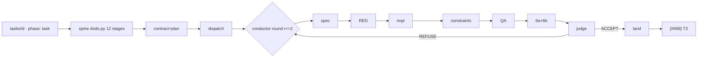

# Archive copy of transport file DIGEST-DESIGN-OUTER-LOOP-2026-10-15.md

> Provenance: verbatim copy of `to-browser/DIGEST-DESIGN-OUTER-LOOP-2026-10-15.md` (transport dir `CLAUDE PROMPT DIR`), archived by the 2026-10-15 night close-out (AMEND-BATCH-NIGHT-CLOSEOUT-2026-10-15 A). Source sha256[:16] fcae08fc38973357. Content below the rule is unchanged except CRLF->LF.

---

kind: DIGEST
date: 2026-10-15
by: design-outer-loop (Claude Code claude-opus-5-5 high; contract to-cc/BATCH-DESIGN-OUTER-LOOP-2026-10-14 v2)
base: main b46836c8. Reads: Copilot served claude-sonnet-5.5 x3, R59 hash + nonce. Checker: codex, served gpt-5.6-sol (section 8 + -checker.md).
summary: Conductor E steps 3-4 as code: doit phases in a round loop, harness-built receipts, constraints as data, psm for [#669]. 6 lanes.

# DESIGN - the outer loop in code (Conductor E completion)

Paths are under scripts/ unless shown. HY = ecosystem/harness.yaml, PR = ecosystem/provider-registry.yaml, VB = validate_backlog.py, GLC = gen_lane_contract.py, R<n> = rung.

**Premise corrections:**
- **P1.** ADR-120 chose doit and no state machine. psm is a CONDITIONAL ratification: "Q14a yes - python-statemachine, if the spike passes" (STANDING_RULINGS.md:5653). No spike has run.
- **P2.** ADR-124 chose tach, not import-linter (D1 :61; S4 rejected, :120). Neither is locked.
- **P3.** `phase:` exists: the body clause, enum VB:103, absence legal (VB:37-40). ROW phases (intake..archive) are [#669]'s; LANE phases (spec..land) run inside build/review/merge.
- **P4.** The pilot's 8 receipts share no shape and have no exit code; its stage 4 missed `scripts/hooks/reuse_gate.py`.

## 1. The loop as code

- **Rounds (O1).** `conductor.py lane --round r` is a stdlib loop. Each round is a fresh acyclic doit run (P2-P7 chained by `task_dep`), with receipts in `LANE-<slug>/r<r>/`. doit stops at the first failure (dodo.py:4); a re-run skips fresh receipts (dodo.py:249-255).
- **Adapter (O2).** `run_phase(argv, timeout_s)` replaces dodo.py:302's timeout-less `subprocess.run`. It kills the process tree with psutil (uv.lock:801, R3), writes KILLED, and writes a 60 s heartbeat (pattern from dispatch.py:2153-2166).

| Step | Module / rung | Out | Gate (exit) | Timeout | Vendor (PR) |
|---|---|---|---|---|---|
| row | VB:103 + conductor.py:178 phase-gate (R1) | phase verdicts | 1 on fail (:737-751) | none | none |
| spine | dodo.py:343, HY:12-24 (R1); doit 0.37.0 uv.lock:408 (R3) | SPINE-NN.json (dodo.py:245) | doit stop | adapter | none |
| distill | GLC:2242 + dispatch.py:1873 plan (R1) | contract + plan JSON | plan_lint:883; GLC:2093 required-tools | n/a | roles PR:615 |
| dispatch | dispatch.py:1821, pre-launch HY:54 (R1) | LAUNCH-*.json (:735) | 5 / 8 | none today -> adapter | V1 |
| P1 spec | claude -p --json-schema (R4) | files_in_scope, red_test_ids, constraints_add | schema + non-empty scope | 20 min | opus-5-5 PR:642 |
| P2 RED | claude -p; gate in code | test commit | red ids FAIL on base, green stays green | 20 min | Sonnet 5.5 (add a `red` role) |
| P3 impl | copilot -p, fallback claude -p | fix commit | red ids pass + ruff | 45 min (pilot: 29 / 45) | PR:660, Copilot first (R104) |
| P4 | section 4 | verdicts | any != 0 | 10 min each | Sonnet, not the producer's vendor |
| P5 QA | ci_verdict + merge_path.py:220, conductor.py:627 | verdict | not PASS / PRE-EXISTING | CI | V3 |
| P6a/b | codex --output-schema / grok; nonce read_gate.py:171 | findings | schema + nonce | 20 min | PR:718, :727; terra vs astra :730; V10 |
| P7 | claude -p --json-schema | ACCEPT / REFUSE + fixes | REFUSE -> round+1; FAILED after r2 | 20 min | opus-5-5 |
| land | merge_path.py:263 (states :293-354) (R1) | main | 1 | CI | V2 |

## 2. The data

- **`phase:`.** Validator unchanged. Distill refuses a row with no `phase:` or not in `task`; parked rows may omit it (VB:37-40).
- **Phase table.** A HY `phases:` block (R1): `{id, row_phase, role, cli, payload_model, gate, timeout_s, budget, max_rounds}`.
- **[#669] transitions.** Each has a trip-test that it fires, and a test that it does NOT fire on the prior state.

| T | From -> to | Trigger | Action | Not on |
|---|---|---|---|---|
| T1 | intake -> task | intake `ACCEPTED`, no carrier row | propose the row (operator files it) | PROPOSED |
| T2 | task -> build | frozen contract, plan_lint 0, preflight 0 | dispatch launch | no contract |
| T3 | merge -> docs -> telemetry | the lane's merge_receipt record on main (logs/MERGE-RECEIPTS.jsonl, V2 WORKS) | gen_task_tree --emit-source; telemetry consumer; propose_closures | an unmerged branch |
| T4 | telemetry -> archive | operator closure approval | archive_row_body.py | proposed, unratified |

  The operator's 5 decisions are guarded transitions (the lane lists them from intake #89 section 3.4).
- **Receipts (O7, O8, O10).** The agent writes only `PhasePayload {outcome, findings[], detail}` (pydantic, `extra="forbid"`). The harness builds `PhaseReceipt` v1:
  - all 10 dodo.py:245 keys, plus `row, lane, phase, round, vendor, cli_version, served_model, started_at, inputs[{path,sha256}], nonce, usage, payload_sha256`;
  - `vendor` = the PR provider of the launched argv head; `served_model` = the CLI's own record (claude `.modelUsage`, the codex session file, copilot `currentModel`).
  - Home: ecosystem/schema/ beside lane_report.py (the pydantic + generated-schema pattern, fed to `--json-schema` at dispatch.py:583-588); pydantic is uv.lock:838.
- **Reading a result:**
  - claude: `-p --output-format json --json-schema S --permission-prompts none --max-budget-usd N` reads `.structured_output`. Not `--bare` (API key, R87).
  - codex 0.155.0: `exec -s read-only --output-schema f -o last.json -`.
  - copilot 1.0.98: no schema flag, so the agent writes payload.json and pydantic validates it.

## 3. Runner matrix

- **Weights:** unattended 20, code 15, library-first 15, model-agnostic 15, OS 10, tokens 10, testable 10, maintenance 5.
- **Scoring:** 0-5 per cell; total = sum of w x s / 5. Anchors: 5 = documented or measured property; 3 = plausible, unprobed; 1 = documented absence. A 4 or 5 with no citation is capped at 3 (the decide_checks.py matrix rule; O13).

| Option | Unatt | Code | Lib | Model | OS | Tok | Test | Mnt | Total |
|---|---|---|---|---|---|---|---|---|---|
| a. conductor + doit | 3 | 5 | 4 | 5 | 4 | 5 | 5 | 4 | 86 |
| b. dynamic workflows | 2 | 4 | 3 | 1 | 3 | 2 | 2 | 3 | 49 |
| c. state machine only (no runner) | 3 | 5 | 4 | 5 | 5 | 5 | 5 | 4 | 88, ineligible |
| d. durable engine | 5 | 5 | 2 | 5 | 3 | 5 | 3 | 2 | 80 |
| **e. (a) + psm for [#669] + pydantic** | 3 | 5 | 5 | 5 | 4 | 5 | 5 | 4 | **89** |

Evidence:
- **(a)** doit 0.37.0 (2026-02, MIT, 488k downloads/month) is the spine; argv for 3 vendors at dispatch.py:553-596; OS per ADR-127. Unattended capped at 3: resume after a kill is unprobed (ADR-120:40).
- **(b)** "No direct filesystem or shell access from the workflow itself"; Claude agents; resume "in the same session" (docs/workflows). Audits only.
- **(c)** python-statemachine 3.2.1 (2026-08-01, MIT, 1.39M/month, 8 releases in 12 months, 0 runtime deps). CVE-2026-47103 (SCXML eval, 9.8) hits 3.0-3.1.x: pin ==3.2.1, no SCXML. transitions 0.9.3 (last release 2025-07): rejected.
- **(d)** DBOS 3.2 (SQLite, 240 releases/yr); Prefect 3.8, Temporal 1.34 and Hatchet all need a server. Receipts already resume, so rejected (rung 6).

**Recommendation: (e). PENDING-MAP V9.**
- Witnesses (O12): a toy halts (V9); a mid-phase kill resumes; stale input re-runs; separate worktrees get separate doit dbs (dodo.py:65-74); no surviving process tree.
- If V9 shows doit BROKEN: conductor.py drives the phases through the same adapter (R2).

## 4. Constraint gate (R48)

- **Registry:** HY `constraints:` = `{id, kind: deterministic|judgement, checker argv, applies_when{change_kind[], paths[], always}, reuses}`.
- **Mandatory baseline, always selected (O9):** C-TASK, C-SCOPE, C-RED, C-VENDOR, C-CLEAN. An empty selection is a refusal, with a RED test.

| id | Checker (reused first) |
|---|---|
| C-LIB | stage_library_first.py run (deptry, uv.lock:319) + stage_prior_art.py; judgement: isolated Sonnet |
| C-DUP | generate_organ_index.py --check + file_purpose_graph.py why (paths from the index, P4); reuse_gate stays at write time |
| C-DEP | file_purpose_graph.py stats + grimp importers (system_map.py) + impacted_tests.py; tach after ADR-124 step 2 |
| C-CLEAN | ruff extend-select + C90 (ADR-124 D1) |
| C-TASK | VB + gen_task_tree --check + backlog-id-on-close |
| C-SCOPE | diff names within P1 scope and the row's `touches:` (fnmatch). NEW, about 30 lines: pre-commit `files:` is per hook; plan_lint class 1 compares contract to contract |
| C-RED | the P2 receipt + test_pairing.py (HY:72) + the test commit before the fix commit |
| C-VENDOR | harness-derived reviewer and judge vendor != producer's (O10); decide_checks.py:249-270; fails closed |

- **Also reused:** plan_lint; GLC required-tools per phase transcript; read_gate.verify_read; routing_agreement.compare_order (:426).
- **Selection:** spine stage 12 computes the set in code; P1 may add, never remove (ADR-81).
- **Checking:** P4 is a doit group `constraint:<id>`, one process each; a judgement checker is a fresh `claude -p` that sees only the diff and the evidence.

## 5. Steel-thread row: [#1430] (P2, S, no deps, one script)

- **Done-when (verbatim):** "the CLI writes its output as UTF-8 whatever the console encoding (`sys.stdout.reconfigure` or an explicit encoder); a test runs it with cp1252 stdout redirected".
- **Unmet on main:** b4e4ed59's `reconfigure(errors="replace")` (verify_handoff_probes.py:1996-2000) degrades glyphs and stays cp1252. P1 must cite it.
- **Planted failure, halts at P2:** the RED test is "a redirected cp1252 run exits 0", which tests/test_verify_handoff_probes.py:2923-2935 already passes on base. P2 exits 1, P3 never starts, and the row stays at `phase: build`.
- **Real run (O11):** the raw stdout bytes must decode as strict UTF-8 and contain `→`. That is RED on base; the fix is `reconfigure(encoding="utf-8")`.
- **Done (R105 D6):** closed on main, one receipt per phase, the plant halted at P2.

## 6. ADR draft: ADR-130 "The outer loop runs in code - Conductor E completion" (Proposed)

- **Context:** R105 D1-D6 (OLR v2 section 3): finish E, B first.
- **Decisions:** D1 lane phases = HY `phases:`, one process each, doit inside the round loop. D2 a harness-built receipt; the agent owns only its payload. D3 [#669] on psm ==3.2.1 if the Q14a spike passes, else a stdlib table. D4 constraints = HY rows with a mandatory baseline. D5 no workflow engine. D6 dynamic workflows audit-only.
- **Options:** section 3. **Consequences:** no orchestrator LLM; all vendors first-class; at most 1 new dependency; a red main blocks P5.
- **R105 amendments:** R104: code picks what runs next; Opus keeps plan, judge and review. R99: the phase table orchestrates; dispatch stays the only launch path. [#689] gets an R105 D2 note.
- **Quality:** no lost step; a trip-test per transition; USD per row.

## 7. BUILD batch (6 lanes; B6 last)

| Lane | [#id] | Done-when, RED first | Deps | Files | Producer -> reviewer | Rung | Map |
|---|---|---|---|---|---|---|---|
| B1 D5(a) | [#1454] open | its (1)-(4): INDEX by seat, `by:` lint, janitor count equal | none | transport.py, transport_lint.py, tests | Copilot -> terra | R1 | V5 |
| B2 D5(c) | NOT VERIFIED, needs filing (Q1) | R100-R108 in section-AT shape; `decision_coverage.py rulings` = 0 unlanded; a seeded unlanded ruling fails | Q1 | protocols/STANDING_RULINGS.md, decision_coverage.py | Sonnet -> terra | R1 | - |
| B3 R108 | [#863] + [#912] open | [#863] (1)-(4) in full; [#912] 45 ids green or owned by 10-31 (R108 says 40, P0 says 58) | none | settings.json, fleet_health.py, session_end_backpressure.py, block_immutable_edits.py, KNOWN-REDS-REGISTRY.json, tests | Copilot -> terra + grok | R1+R3 | V3, V7 |
| B4 [#689] step | [#689] open | a step, not the close: distill refuses an unphased row; toy halts; section 3 witnesses; forged payload refused; each C-* exits 1 on a seed; empty selection refused | none | HY, dodo.py, VB, GLC, ecosystem/schema/phase_receipt.py, [#689] note, tests | Copilot -> terra + grok, Opus | R1+R3 | V9, V1 |
| B5 [#669] | [#669] open; depends on [#664] (Q2) | step 0: psm spike as RED trip-tests, verdict before the lockfile edit; then 4 fire, 4 do not fire, 5 decisions named, archive by trigger | B4 + Q2 | conductor.py, archive_row_body.py, propose_closures.py, pyproject.toml, uv.lock, tests | Copilot -> terra + grok, Opus | R4 / R2 | V9 |
| B6 steel | [#1430] open | section 5 | B4 (+B5) | verify_handoff_probes.py + its test | the loop -> 6a/6b -> Opus | R1 | V2 |

- **Overlap:** none. B4 owns HY and dodo.py; B5 owns conductor.py and the lock; B3 owns settings.json.
- **Order:** B1, B3, B4 now; B2 on Q1; B5 after B4 and Q2; B6 last (without B5, T3 runs by hand).

## 8. CHECKER: codex exec -m gpt-5.6-sol -s read-only, stdin closed, digest-only

- Draft sha16 34e610efb3228854; served gpt-5.6-sol; nonce OK; 89 s; **VERDICT: REJECT**.
- The objections are verbatim, with evidence and fixes, in `-checker.md` (they do not fit under the 15 KB cap).

| O | Sev | Claim | Disposition |
|---|---|---|---|
| O1 | H | REFUSE loop impossible in an acyclic doit chain | ACCEPT: round loop, per-round receipts |
| O2 | H | `timeout_s` cannot fire (dodo.py:302) | ACCEPT: adapter, psutil tree-kill, RED test |
| O3 | H | B5 starts before open [#664] | ACCEPT: gated on Q2 |
| O4 | H | [#1378] is verification-only | ACCEPT: dropped; B2 waits on Q1 |
| O5 | H | B3 misses the [#863] / [#912] Done-whens | ACCEPT: both carried in full |
| O6 | H | [#689] Done-when is metrics; its runner is Actions | PARTIAL: B4 is a step. REJECT "not doit": the row says "Fallback is B -- same phase table, run locally", and R105 D2 rules B first |
| O7 | H | Copilot receipt forgeable | ACCEPT: payload-only |
| O8 | H | Not a superset of the dodo.py keys | ACCEPT: all 10 kept |
| O9 | H | Empty selection passes | ACCEPT: baseline of 5 |
| O10 | H | Vendor is self-declared | ACCEPT: from argv plus the CLI record |
| O11 | H | Steel-thread assertion wrong | PARTIAL: no replacement chars were expected; reworded as strict UTF-8; :2923-2935 becomes the plant |
| O12 | M | V9 toy does not prove durability | ACCEPT: +4 witnesses |
| O13 | M | Scores lack evidence | ACCEPT: anchors + cap; ranking unchanged |
| O14 | M | Spike and adoption in one lane | PARTIAL: spike is step 0, both outcomes frozen. REJECT a 7th lane (ADR-110) |

## 9. Open questions (3)

- **Q1. D5(c) has no carrier:** [#1446] is closed and [#1378] is verify-only. Recommendation: file the [#1446] twin, "rulings R100-R108 land", at the freeze.
- **Q2. [#669] depends on open [#664]** (669:9). Recommendation: waive for T1-T4, recorded in the row; [#664]'s edges replace the file read later. Without the waiver, B5 drops and T3 runs by hand.
- **Q3. Judge vendor = producer vendor** after a P3 fallback to Claude. Recommendation: allow it as a named C-VENDOR exemption; the judge rules on the non-Claude objections and never scores the diff.

Sources: code.claude.com/docs/en/{headless,workflows} · pypi.org/pypi/<pkg>/json + pypistats.org (13 packages) · python-statemachine.readthedocs.io · cvefeed.io (CVE-2026-47103) · docs.dbos.dev · docs.prefect.io/v3 self-hosted · automationatlas.io (Temporal, Hatchet)
