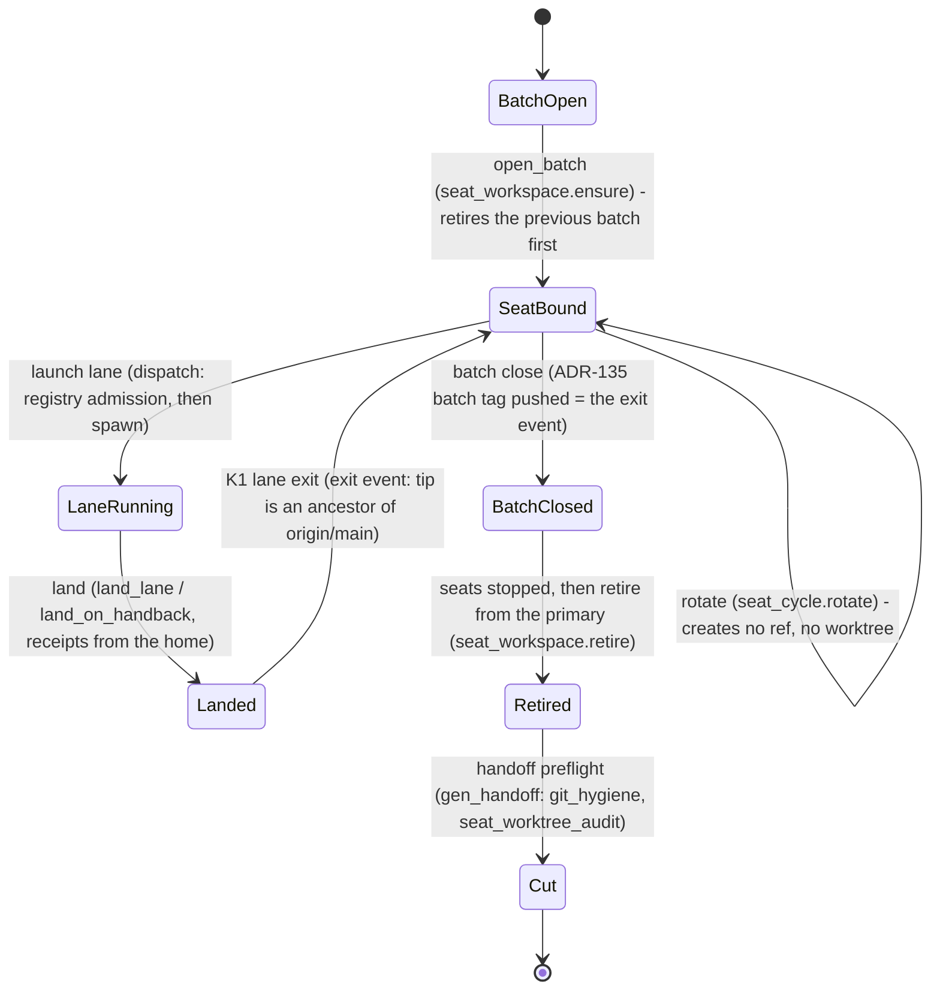

# ADR-140: A seat is a role with one workspace, and its state lives at the primary -- rotation creates nothing, every harness ref has a registered exit, and A1-A7 is a permanent check

- **Status:** Proposed
- **Date:** 2026-11-04
- **Revision:** r2 after the evaluator round (SOL1-SOL11, ARGON1-ARGON10; responses in the evidence file).
- **Decision tier:** Path A -- a `/decide` proposal for operator ratification (R13, ADR-108 section A).
- **Related:**
  - ADR-135, Accepted: batch close carries the pushed batch tag. Its retire step runs at the same moment.
  - ADR-133: the sibling-worktree receipt reads, which I2 makes unnecessary.
  - ADR-84: the protected `automation/fleet-audit` writer.
  - ADR-106: declared dependencies.
  - Rows `[#1869]` (this decision's implementing row) and `[#1868]` (C0 part (a), the process registry, its parent).
- **Decommission:**
  - the per-cycle seat worktree and its `worktree-<seat>-cycle-<n>` branch;
  - the per-checkout fallback of `receipts_dir()`;
  - the HAND-STEP "copy LAUNCH-*.json into the integration worktree" (four instances in E3.0).
- **Source:** the design evidence, `docs/audits/2026-11-04-technical-design-seat-lifecycle.md` (briefs, subagent claims, matrix, pre-mortem, evaluator findings and responses).
  - Transport inputs:
    - PROPOSAL-ADR-SEAT-LIFECYCLE-2026-11-04.md
    - DIGEST-RESEARCH-SEAT-WORKTREES-2026-11-04.md
    - AUDIT-SEAT-WORKTREE-CONSEQUENCES-2026-11-04.md (with its CORRECTION)
  - Operator order: DIGEST-PLAN-SEAT-LIFECYCLE-FIX-AND-CLOSE-2026-11-04.md, P1.

## Context

**Every seat rotation (orchestrator or integrator, cycle N -> N+1) leaves its predecessor's worktree and branch behind.**
- `scripts/seat_cycle.py` `cycle()` runs handover -> launch successor -> wait bound -> stop -> verify. No step removes anything (`scripts/seat_cycle.py:424`).
- The successor is launched through the lane path, `dispatch.successor_lane`. That path cuts `<repo_root>/.claude/worktrees/<slug>` on branch `worktree-<slug>` (`scripts/dispatch.py:2513`, `:2514`).
- `repo_root` defaults to the process cwd (`scripts/seat_cycle.py:624`), so a cycle run from inside a seat worktree nests its successor inside it.
- State is per checkout. `receipts_dir()` is `HUB_ROOT/logs/receipts`, where `HUB_ROOT` is the running file's checkout (`scripts/dispatch.py:870`, `:142`). About 15 other modules recompute the same anchor. Month-bucket writers such as `scripts/propose_closures.py:47` have no override.

**The consequence audit of 2026-11-04 measured the cost:**
- A3: 549 unique `logs/2026-11` files, 7 unique receipts and 22 differing copies across 6 worktrees, so no worktree is removable without loss.
- A4: the live integrator's checkout is nested inside its retired predecessor's.
- A5: a lane queued from the cycle-4 dispatcher worktree ran with that worktree as its cwd and wrote 13 files there after the seat had stopped.
- A7: four hand copies of LAUNCH receipts into an integration worktree in one batch, one of them a refused landing.
- Because no step has an exit, the handoff preflight `git_hygiene` fails on 11 strays.

**Root causes, from the proposal and confirmed by the audit:**
- RC1: a seat (a long-running role) is launched as a lane (a change set) and inherits a branch with no exit.
- RC2: the seat lifecycle has no retire event.
- RC3: state is bound to a disposable checkout.
- RC4: identity is relative to the cwd.
- RC5, the proposal's "rules as prose", is half true. The protected exception is already data (`ecosystem/git-hygiene-allowlist.yaml`, read by `scripts/gen_handoff.py:2087`), but it covers only branches and declares no exit.

## Decision

Direction B of the proposal: one workspace per role per batch, reused by every cycle; one state home anchored at the primary; a ref registry with exits; retirement only at batch close; the audit A1-A7 as a permanent check.

### D0 The seat lifecycle as a process model (diagram first; one responsible module per step)

| step | trigger | responsible module (one) | creates | removes |
|---|---|---|---|---|
| open batch | first seat of a batch | `scripts/seat_workspace.py` `ensure(role, batch)` | `<primary>/.claude/worktrees/<role>-<batch-token>` via `git worktree add --detach`, with no branch | nothing itself; it first calls `retire` for any earlier batch whose tag exists and whose seats are stopped |
| seat bound | `seat_cycle.py bound` | `scripts/seat_cycle.py` | nothing | nothing |
| rotate | `seat_cycle.py cycle` | `scripts/seat_cycle.py` `rotate`: spawns the successor with cwd = the role workspace. It never calls `successor_lane`. | nothing (T6) | nothing |
| launch lane | dispatcher | `scripts/dispatch.py`: registry admission of the intended slug before ANY provider spawn (I3), cwd = the primary (I1) | a lane worktree and `worktree-<slug>` (made by dispatch or by Claude Code's `--worktree`) | nothing |
| land | integrator in `integrate-<batch>` | `scripts/land_lane.py` / `scripts/land_on_handback.py`, reading receipts from the home (I2) | a merge on main | the lane worktree and branch (K1) |
| batch close | integrator command after the last landing (`ecosystem/harness.yaml` batch-close moment) | ADR-135's batch-tag writer | `refs/tags/batch/<id>` (the exit event, git-observable) | nothing |
| retire | the handoff cut, or the next `open_batch`, run from the PRIMARY checkout once both role seats are stopped and verified | `scripts/seat_workspace.py` `retire(batch)` | `archive/<branch>-<short-sha>` for any unmerged tip, pushed and verified first | role workspaces, `integrate-<batch>` and its branch, landed lane leftovers |
| cut | operator | `scripts/gen_handoff.py` preflight (`git_hygiene`, `seat_worktree_audit`) | nothing | nothing |

**Who runs retire.**
- Retire never runs inside a workspace it removes, and never while a role seat is live. Its callers are the cut and the next `open_batch`, both from the primary.
- This answers the "who retires the integrator's own checkout" deadlock (SOL3, ARGON7): the batch-close moment only tags; removal waits for the seats to end.

**Diagram source.** Per R131 (STANDING_RULINGS), this diagram is the TO-BE target. The lane makes `seat_workspace.py` the code `gen_process_diagrams.py` renders.

### D1 Role workspace (I4: one retire point)

- **Two role workspaces per batch**, one per seat role. The role is a closed enum, `orchestrator | integrator`, held in the registry (ARGON10).
  - Path: `<primary>/.claude/worktrees/<role>-<batch-token>`.
  - The batch token is the batch id with `.` replaced by `-` (`e3.0` -> `e3-0`), the form seat names already use (`orchestrator-e3-0-cycle-5`). It also passes `worktree_occupancy._SLUG_RE` (`scripts/worktree_occupancy.py:55`; ARGON2).
  - Created detached, with no branch.
- **The integrator's role workspace is NOT `integrate-<batch>`** (SOL1, ARGON3).
  - `integrate-<batch>` stays the landing workspace: registry kind `integration`, with its branch, mutated by `land_lane` (`scripts/land_lane.py:292-306`).
  - The integrator seat's session runs in `integrator-<batch-token>` and does its landings in `integrate-<batch>`, as today.
- **Read-only to git.** No seat commits, checks out or resets in a role workspace.
  - A seat that must author a commit (such as this ADR) does so in a lane worktree, or in `integrate-<batch>` for the integrator.
  - A pre-commit hook refuses a commit whose worktree is a registered role workspace (test T14).
- **No refresh during overlap** (SOL1, ARGON3).
  - A role workspace's HEAD moves only in `rotate`, after the predecessor's stop is verified, and only when `git status --porcelain` is empty and HEAD is an ancestor of origin/main (no unpublished commit).
  - Seats read current main by `git fetch` plus `git show origin/main:<path>`, not by moving HEAD.
- **Rotation has its own launch path** (ARGON2).
  - `seat_cycle.rotate` spawns `claude --bg` with cwd = the role workspace. It does not call `dispatch.successor_lane`, which requires a branch and refuses a detached tree (`scripts/dispatch.py:2525-2532`).
  - The occupancy check for a role workspace admits exactly one live session besides the successor: the predecessor, named by its job id.
- **Stop verification is by process identity** (SOL10, ARGON1).
  - `verify_stop` in a role workspace matches the predecessor's job id and session id only, never the workspace path. Today `find_processes([job_id, worktree])` at `scripts/seat_cycle.py:298` would match the live successor and fail every in-place rotation.
  - Test T6b covers this with a live successor.

### D2 Invariants as mechanisms

- **I1 Anchor.**
  - Every harness worktree is created at the primary, resolved from `git rev-parse --path-format=absolute --git-common-dir` (its parent).
  - The build reuses the one wrapper, `land_on_handback._primary` (`scripts/land_on_handback.py:148`), moved to `scripts/seat_workspace.py` and imported back.
  - `seat_cycle.py --repo-root` and `dispatch.py`'s `repo_root` / `cwd` defaults resolve through it. An explicit root that is not the primary is refused, naming the primary.
  - Every launch path spawns with cwd = the primary, so Claude Code's own `--worktree <slug>` lands under the primary too.
- **I2 One state home.**
  - Receipts (`logs/receipts/`) and month-bucket logs (`logs/<YYYY-MM>/`) resolve through one function, `seat_workspace.state_home()`.
  - Precedence: `HARNESS_RECEIPTS_DIR` (the unchanged override), then `<primary>/logs`.
  - **The caller set is enforced by a census test, not by a list** (SOL4, ARGON4). Test T15 fails on any `scripts/**/*.py` that builds a `logs/receipts` or `logs/<month>` path outside `state_home()`.
  - The known set at 33005b8c2 includes `dispatch.receipts_dir`, `dodo._receipts` (`scripts/dodo.py:85-86`), `gates`, `test_pairing`, `handback` (`:432`), `subst_gate`, `merge_path`, `land_lane`, `round_receipts`, `conductor`, `propose_closures`, `audit`, `fleet_health` (receipt only), `lane_end_guard`, `reuse_gate`, `memory_admission_gate`, `backlog_reconcile`, `check_organ_truth`, `test_flow_metrics` and `system_view`. The test, not this list, is the authority.
  - **Shared-home writes are exclusive.** A writer that allocates a name in the home creates it with exclusive create (`open(..., "x")`) and retries on `FileExistsError`. `propose_closures._next_free_dated_path` plus `write_text` (`scripts/propose_closures.py:461-473`) is the known instance (SOL2). T5 runs two writers concurrently.
  - **Rebuildable caches stay per checkout:** top-level `logs/FLEET-HEALTH.md`, `logs/SESSION-START-FULL.txt`, `logs/OPERATOR-LOAD.csv`, `logs/HOOK-*`. A named list in the registry lets the audit classify them as CLEAN-rebuildable (ARGON6).
- **I3 Exit-path registry.**
  - `ecosystem/git-hygiene-allowlist.yaml` is EXTENDED, not replaced. It keeps `branches:`, the protected entries with owners, and gains `kinds:` and `roles: [orchestrator, integrator]`.
  - Every kind declares a name pattern bound to an instance key and an exit event that git can observe (SOL6, ARGON7):

| kind | instance | exit event (git-observable) |
|---|---|---|
| `lane` | `worktree-<slug>` and `.claude/worktrees/<slug>` | the tip is an ancestor of `origin/main` |
| `integration` | `integrate-<batch>` and `worktree-integrate-<batch>` | `refs/tags/batch/<batch>` exists on origin (ADR-135 D4) |
| `role-workspace` | `<role>-<batch-token>`, no branch | the same batch tag exists |
| `protected` | the `branches:` entries | never |

- **I3, continued.**
  - **Admission.** Creating a ref or worktree that matches no kind is refused, before any provider spawn: in `seat_workspace.ensure` and in `dispatch.py` before `spawn` on every launch path, including the `--worktree` delegations at `scripts/dispatch.py:636` and `:678-679` (SOL5).
  - **git_hygiene:**
    - A registered instance before its exit event passes. After its exit event it is stray. A ref matching no kind is stray.
    - The running checkout's exemption (`scripts/gen_handoff.py:2107-2118`) is kept only for the PRIMARY. A linked running checkout is judged by its kind like any other, so the no-leftovers gate is not weakened.
- **I4 Startup prune.**
  - `seat_workspace.ensure` runs `git worktree prune`.
  - For each worktree locked with a `--reason` carrying a PID, a dead PID's lock is released and reported. A directory is never force-removed.
- **Liveness is its own check** (SOL7). Retire and the role-workspace occupancy check use `seat_workspace.session_live(job_id)`:
  - live when `~/.claude/jobs/<id>/state.json` is not `stopped`/`done`, OR a process carries the job id;
  - an unreadable record counts as live (fail closed).
  - `worktree_owners`' transcript test (`scripts/gen_handoff.py:1623-1646`, which treats a detached HEAD as owned) is not used for this.

### D3 Audit A1-A7 as a permanent check

- **One read-only module:** `scripts/seat_worktree_audit.py`.
  - Legs A1-A7 exactly as the P0 audit, with a verdict CLEAN / LOST-RISK / COLLISION / STALE per item.
  - The A5 stop time comes from the seat's job record.
  - A3 classes come from the registry, so a rebuildable cache is CLEAN.
- **Blocking predicate, narrowed** (SOL9, ARGON5). The preflight row `seat_worktree_audit` (scope cut, blocking) fails only on CURRENT-STATE legs:
  - A1 (unaccounted commits);
  - A2 dirt in a LINKED worktree;
  - A3 LOST-RISK;
  - A4 nesting.
  
  History legs A5-A7, the primary's tracked hook dirt (A2) and the stale producer (A6) are reported, never blocking. They are compared against `ecosystem/seat-audit-baseline.yaml`, so only a NEW history item is surfaced as new.
- **Where it runs:**
  - the preflight row;
  - a reporting step at the end of `seat_cycle.rotate`;
  - the precondition of `retire`, per worktree.

### D4 Migration (move, never delete): one per non-CLEAN audit item

`seat_workspace.migrate(worktree)` has these rules:
- **Copy, verify, never unlink.** It copies and verifies sha256. Sources are unlinked only by `retire`, after the session is verified stopped (ARGON8). Live seat worktrees are migrated only after their seat rotates out.
- **Idempotent.** A second run copies nothing (T9).
- **Conflict rules by class** (SOL8, ARGON8):
  - `LAUNCH-*.json`: the canonical name in the home holds the receipt with the latest launch timestamp for that slug and batch. The other copy goes to `logs/migrated/<worktree>/`. Test T16 lands from the migrated home and checks the conductor-gate selection (`scripts/land_on_handback.py:172-177`, `:351-357`).
  - Append-only `*.jsonl` (`WHY-SEARCHES.jsonl`, ...): line-union in source order, exact duplicates dropped.
  - Any other differing file: side by side under `logs/migrated/<worktree>/<relpath>`, never overwriting.
  - Rebuildable caches: not copied (I2).

| audit item | migration |
|---|---|
| A3 orchestrator-e3-0-cycle-4: 151 logs/2026-11 files, LAUNCH-JOB-1da14f10.json, 7 differing (6 MOMENT receipts, 1 cache) | copy to the home; the MOMENT receipts go side by side; the cache is not copied |
| A3 integrator-e3-0-cycle-4: 111 logs, 3 receipts (incl. LAUNCH-JOB-44bb7342.json), 7 differing | same; retired only after the nested worktree (A4) |
| A3 integrator-e3-0-cycle-5 (200 logs), orchestrator-e3-0-cycle-5 (56 logs) | migrated after these seats rotate into their role workspaces (P4) |
| A3 e30-landing-stage-receipts: 31 logs, WHY-SEARCHES.jsonl, 4 differing | copy; the jsonl is line-merged; landed, so its lane exit has passed |
| A3 integrate-e3.0: 2 unique and 2 differing LAUNCH receipts | the LAUNCH rule above; it retires at the cut after the batch tag |
| A4 integrator-e3-0-cycle-5 nested in integrator-e3-0-cycle-4 | the live integrator rotates into `integrator-e3-0` first; then retire removes the child before the parent |
| A5 13 late files in orchestrator-e3-0-cycle-4 | they are A3 `logs/2026-11` files and are copied as above. Their stale `head_commit` is kept as written, and the A5 item enters the baseline as history |
| A2 untracked `to-browser/archive/2026-11/QUESTION-toy-1ba5eb09.md` in orchestrator-e3-0-cycle-4 | copied to `logs/migrated/orchestrator-e3-0-cycle-4/...` (the transport keeps its own copy) |
| A1 worktree-{orchestrator,integrator}-e3-0-cycle-{4,5}, worktree-e30-landing-stage-receipts (local and origin), origin/worktree-integrate-e3.0, and this run's `docs/adr-140-seat-lifecycle` once landed | removed by retire once merged; an unmerged tip gets a pushed and verified archive tag first |
| A7 four receipt hand copies; A6 LEDGER offline `main:`; A2 primary hook dirt | baseline history (reported, not blocking). A6 and the primary dirt are candidate rows outside this lane |

### D5 Test plan (RED first: each test is written and seen failing on origin/main before the code; a test that cannot be RED is labelled a regression guard)

| id | test | invariant |
|---|---|---|
| T1 | a launch from cwd inside a linked worktree is created at the primary's `.claude/worktrees`, never nested | I1 |
| T2 | an explicit `--repo-root` that is not the primary is refused, naming the primary | I1 |
| T3 | a queue launch run from a role workspace writes its LAUNCH receipt to `<primary>/logs/receipts` | I2 |
| T4 | `launch_receipt_problems` run in an integration worktree finds a receipt that exists only in the home | I2 |
| T5 | two concurrent `propose_closures` writers from two linked worktrees produce two distinct files in the home's month bucket, neither overwritten | I2 |
| T6 | `seat_cycle.rotate` with a fake spawn leaves `git worktree list` and `git branch -a` byte-identical | I4 |
| T6b | `verify_stop` passes for a stopped predecessor while a live successor process runs in the same role workspace | D1 |
| T7 | creating a ref or launching a slug that matches no registry kind is refused before spawn (regression guard: the protected entry still passes `git_hygiene`) | I3 |
| T8 | the SAME registered instance passes `git_hygiene` before its exit event and is stray after it, for a lane (landed) and for a role workspace (batch tag pushed) | I3 |
| T9 | `migrate` twice: the second run copies 0 files; a differing file is kept side by side; a jsonl is line-merged | D4 |
| T10 | the audit on a fixture repo yields one of each verdict, and only current-state legs block | D3 |
| T11 | `retire` refuses a worktree with a live session (`session_live`), a nested worktree, a dirty tree, an unmerged tip without a verified archive tag, or its own cwd | D0, D4 |
| T12 | the startup prune releases a lock whose PID is dead and keeps one whose PID is live | I4 |
| T14 | the pre-commit hook refuses a commit in a registered role workspace | D1 |
| T15 | census: no `scripts/**/*.py` builds a receipts or month-bucket path outside `state_home()` | I2 |
| T16 | after migrating two conflicting LAUNCH receipts, landing reads the latest one and selects the same gate as before the migration | D4 |

**Acceptance (plan P4)** runs the landed code with no hand step:
1. Migrate.
2. Rotate both seats into their role workspaces. The first real rotation is the live overlap witness that T6 cannot be (SOL11). If two sessions cannot share a cwd, the flip-condition fires.
3. Stop the old seats.
4. Retire from the primary.

The pass condition is `seat_worktree_audit` with no blocking item and `git_hygiene` PASS. If a hand step is needed, that is a defect in the lane.

### D6 Review chain for the implementing lane (architect under D1; recorded as a measured trial)

The lane's chain, per DIGEST-PLAN P2, is RED (T1-T12), then CI, then a reviewer (terra), then the judge (gpt-6.1-sol). The judge reads CI itself; review-2 and the T2 reader are not run. This is a trial for M1 of DIGEST-CEREMONY-OR-VALUE-2026-11-04, reversible at the next ruling.

## Quality attributes

- **Quality attribute(s):** recoverability (no state is lost when a workspace goes), integrity (nothing is created that has no registered exit), operability (rotation and landing need no hand step).
- **Scenario:**
  - **Source:** the dispatcher or integrator seat at its context or age threshold (`ecosystem/seat-cycle.yaml`).
  - **Stimulus:** `seat_cycle.py cycle` runs, from any cwd, including a linked worktree.
  - **Artifact:** `seat_cycle.py`, `dispatch.py`, `seat_workspace.py`, the registry, the state home.
  - **Environment:** a batch in flight, with lanes queued from the seat workspace, and an integrator landing from `integrate-<batch>`.
  - **Response:**
    - The successor binds in the same role workspace.
    - No worktree or branch is created.
    - Every launch receipt is in `<primary>/logs/receipts`.
    - The lander finds it there.
    - After batch close and the seats' stop, `retire` (run from the primary) leaves only main, the protected refs and the primary.
- **Response measure:**
  - Per rotation: 0 worktrees and 0 branches created, measured by T6 and by the audit run each cycle.
  - Per batch: 0 hand copies of receipts (the A7 count).
  - At the cut: `git_hygiene` PASS and `seat_worktree_audit` with no blocking item, 0 hand steps. Today's value is 11 strays and 549 + 7 + 22 at-risk files.
- **Decision evidence:** the matrix in `docs/audits/2026-11-04-technical-design-seat-lifecycle.md` (B 3.25 over C 2.85, A2 2.45, A 2.15 and O0 1.75), its footnote [^2] (the git-common-dir anchor already runs at `scripts/land_on_handback.py:148`), and the audit's measured counts.

## Flip-condition

Any of these sends the decision back:
- **T6 cannot be made to hold** because Claude Code's `--bg` session for the successor must have a distinct worktree, for example because two sessions in one cwd collide on `.claude/scheduled_tasks.lock`. Then option A2 (teardown per cycle plus the state home) replaces D1, and I1-I3 and D3-D4 stand unchanged.
- **The operator rules sibling worktrees outside the repo**, a reserved act. Then I1's anchor is unchanged but the location moves; this ADR is amended, not superseded.
- **After two batches the audit still finds LOST-RISK** in a retired workspace. Then I2's scope (receipts + `logs/<month>`) is too narrow, and the next class joins the home by row.

## Alternatives considered

- **O0 status quo:** rejected on measured loss. The audit counted 549 unique files, 11 strays and 4 hand steps in one batch.
- **A, a teardown in cycle():** rejected. It keeps a create/destroy pair on every rotation, plus a harvest. In the research digest's words, it institutionalizes the binding of a branch to a session.
- **A2, teardown plus the state home:** kept as the flip-condition fallback. Without a harvest it is safe, but every rotation stays a git write that can fail mid-handover.
- **C, seats in the primary checkout:** rejected. It couples seats to the operator's checkout, which sat behind origin/main all day (A6), and puts two committing sessions in one checkout, which AGENTS.md "Landing a change" forbids.
- **A second registry file:** rejected. `ecosystem/git-hygiene-allowlist.yaml` already exists, holds the protected exception as data, and is read by `git_hygiene`. One registry is extended so the check and the creation refusal read the same data.

## Consequences

- Seats stop owning branches. The `worktree-<seat>-cycle-<n>` form disappears from new launches; existing ones are retired by the first batch close under the new code.
- A seat's ad-hoc commit (such as this ADR's) moves to a lane or the integration worktree.
- `HARNESS_RECEIPTS_DIR` keeps its meaning as an override. Its fallback moves from the running checkout to the primary.
- ADR-133's sibling-worktree receipt reads become unnecessary for new receipts. It is not amended here.
- The batch-close moment only tags (ADR-135). `retire` runs from the primary at the cut or the next batch open. The preflight gains one row (`seat_worktree_audit`). `seat_cycle` gains `rotate` and an identity-based `verify_stop`; seat rotation stops using `dispatch.successor_lane`.
