P1 dispatch only — the handoff process is not yet bound

```mermaid
stateDiagram-v2
    direction LR
    state "Drafted" as drafted
    state "Emitted" as emitted
    state "Checked" as checked
    state "Planned" as planned
    state "Queued" as queued
    state "Held dependency" as held_dependency
    state "Held capacity" as held_capacity
    state "Prelaunch" as prelaunch
    state "Launching local" as launching_local
    state "Launching codespace" as launching_codespace
    state "Launching cloud" as launching_cloud
    state "Launch incomplete" as launch_incomplete
    state "Running" as running
    state "Running cloud" as running_cloud
    state "Stalled" as stalled
    state "Resuming" as resuming
    state "Handed back" as handed_back
    state "Harvesting" as harvesting
    state "Integrating" as integrating
    state "Merged" as merged
    state "Refused" as refused
    state "Repairing" as repairing
    state "Reported" as reported
    state "Blocked failed" as blocked_failed
    state "Failed" as failed
    [*] --> drafted
    merged --> [*]
    reported --> [*]
    blocked_failed --> [*]
    failed --> [*]
    drafted --> emitted : Emit
    emitted --> checked : Check [contract_ok, lint_clear, tier_within_role]
    emitted --> drafted : Check [checks_failed]
    checked --> planned : Plan [token_cap_set]
    planned --> queued : Enqueue [no_cycle]
    queued --> merged : Evaluate [is_merged]
    queued --> running : Evaluate [is_live]
    queued --> running_cloud : Evaluate [is_live_cloud]
    queued --> blocked_failed : Evaluate [dep_failed]
    queued --> held_dependency : Evaluate [blocked_by_dependency]
    queued --> held_capacity : Evaluate [blocked_by_capacity]
    queued --> prelaunch : Evaluate [clear]
    held_dependency --> merged : Evaluate [is_merged]
    held_dependency --> running : Evaluate [is_live]
    held_dependency --> running_cloud : Evaluate [is_live_cloud]
    held_dependency --> blocked_failed : Evaluate [dep_failed]
    held_dependency --> held_dependency : Evaluate [blocked_by_dependency]
    held_dependency --> held_capacity : Evaluate [blocked_by_capacity]
    held_dependency --> prelaunch : Evaluate [clear]
    held_capacity --> merged : Evaluate [is_merged]
    held_capacity --> running : Evaluate [is_live]
    held_capacity --> running_cloud : Evaluate [is_live_cloud]
    held_capacity --> blocked_failed : Evaluate [dep_failed]
    held_capacity --> held_dependency : Evaluate [blocked_by_dependency]
    held_capacity --> held_capacity : Evaluate [blocked_by_capacity]
    held_capacity --> prelaunch : Evaluate [clear]
    prelaunch --> launching_local : Prelaunch passed [substrate_is_local]
    prelaunch --> launching_codespace : Prelaunch passed [substrate_is_codespace]
    prelaunch --> launching_cloud : Prelaunch passed [substrate_is_cloud_read_only]
    prelaunch --> failed : Prelaunch passed [substrate_is_cloud_writing]
    prelaunch --> failed : Prelaunch refused [substrate_is_cloud_writing]
    prelaunch --> queued : Prelaunch refused [!substrate_is_cloud_writing]
    launching_local --> running : Spawned [job_identified]
    launching_local --> launch_incomplete : Spawn incomplete
    launching_local --> queued : Launch refused [launch_attempts_left]
    launching_local --> refused : Launch refused [!launch_attempts_left]
    launching_codespace --> running : Box started
    launching_codespace --> held_capacity : Box limit
    launching_codespace --> queued : Launch refused [launch_attempts_left]
    launching_codespace --> refused : Launch refused [!launch_attempts_left]
    launching_cloud --> running_cloud : Cloud started
    launching_cloud --> failed : Launch refused
    launch_incomplete --> running : Identified [identify_tries_left]
    launch_incomplete --> failed : Give up [!identify_tries_left]
    running --> stalled : Idle [is_idle]
    running --> handed_back : Handback [handback_on_local]
    running --> harvesting : Box done [substrate_is_codespace]
    running_cloud --> reported : Cloud done
    running_cloud --> failed : Cloud failed
    stalled --> failed : Give up [!resumes_left]
    stalled --> resuming : Resume [resumes_left]
    resuming --> failed : Give up [!resumes_left]
    resuming --> running : Resumed
    handed_back --> integrating : To integrator [!read_only]
    handed_back --> reported : Report [read_only]
    harvesting --> reported : Report [harvest_clean_read_only]
    harvesting --> integrating : Harvested [harvest_clean_writing]
    harvesting --> refused : Refusal [!harvest_clean]
    integrating --> refused : Refusal [!landed]
    integrating --> merged : Merge [landed]
    refused --> repairing : Repair [repair_allowed]
    refused --> failed : Fail [!repair_allowed]
    repairing --> running : Repaired [worktree_exists]
    repairing --> failed : Fail [!worktree_exists]

    classDef browser fill:#a5d8ff,stroke:#1971c2,color:#111
    classDef harness fill:#b2f2bb,stroke:#2f9e44,color:#111
    classDef both fill:#ffd8a8,stroke:#e8590c,color:#111
    class drafted browser
    class emitted harness
    class checked harness
    class planned harness
    class queued harness
    class held_dependency harness
    class held_capacity harness
    class prelaunch harness
    class launching_local harness
    class launching_codespace harness
    class launching_cloud harness
    class launch_incomplete both
    class running harness
    class running_cloud harness
    class stalled harness
    class resuming harness
    class handed_back harness
    class harvesting harness
    class integrating harness
    class merged harness
    class refused both
    class repairing harness
    class reported both
    class blocked_failed harness
    class failed both
```

Reference pictures (`to-browser/`), hand-built, verified 2026-10-23:

- `MAP-HARNESS-AS-IS-r3`
- `MAP-HARNESS-TO-BE-r3`
Numbers: 25 states · 22 holes · 15 glue · 3 zones
